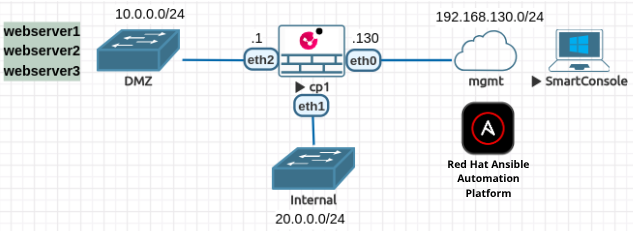
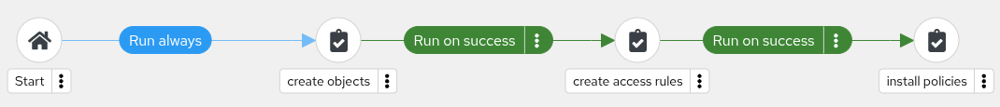

# Check Point automation with Ansible

This project demonstrates an example of automating Check Point configuration using the Ansible Automation Platform. A standalone deployment is used meaning both the Security Gateway and Security Management Server components are installed on the same virtual machine. The following topology is used:




Below Job Workflow is used to automate the configuration of Check Point objects (networks, hosts, and groups), security policies and the automatic installation of the policy. It enables http/https traffic from Internal_Network to Web_Servers group in DMZ and from Mgmt_Network to cp1 node:



As we can see the modular approach is used here so separate Job Templates are used per particular functionality automation. It is implemented by using Ansible Tags in Roles and on Job Templates level. This hierarchy is also reflected in variables definition in group_vars folder (separate variables file per functionality).  
  
## Credentials

The Check Point username and password are not stored in this repository. Ansible logs in to the Management Server API through the _httpapi_ connection set in _inventory_ and all tasks reuse that session, so no playbook or variable file refers to them.

How to use credentials:
1. Ansible Automation Platform: create a credential of type _Machine_ with the Check Point username (e.g. _admin_) and password, and attach it to each Job Template. AAP stores it encrypted and passes it to Ansible at run time.

2. Command line: pass the username and let Ansible prompt for the password:

```
ansible-navigator run playbooks/manage_configuration.yml -m stdout -u admin -k
```

## Author

[@mzdyb](https://www.linkedin.com/in/michal-zdyb-9aa4046/)
